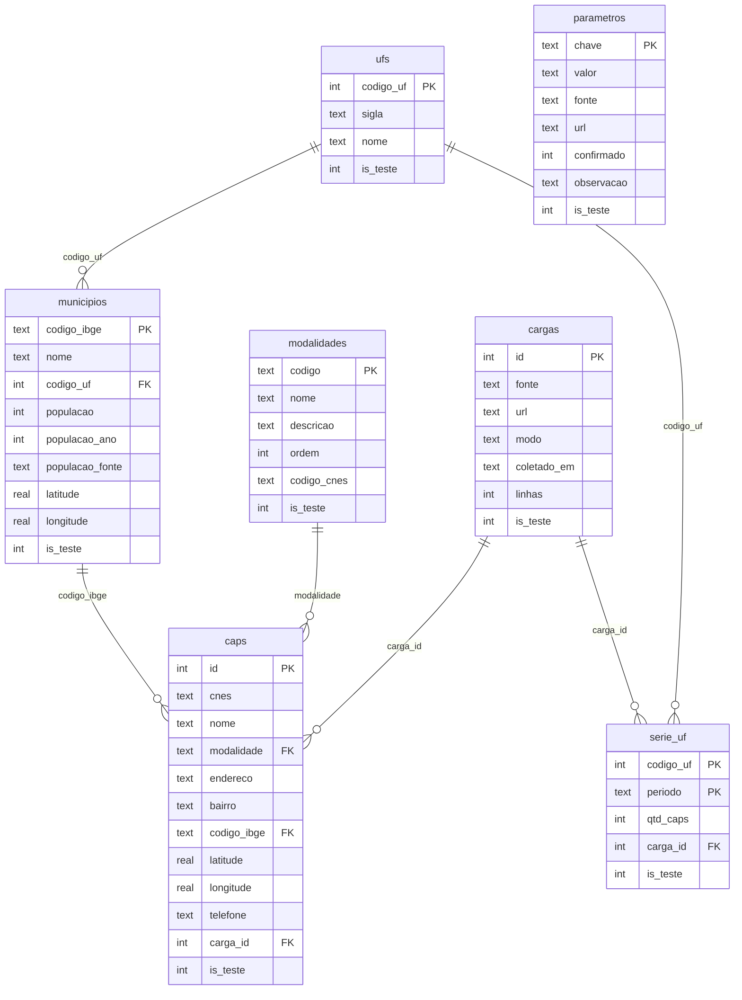

# Acolhe CAPS

Sistema web de localização e orientação sobre serviços públicos de saúde mental da **Rede de Atenção Psicossocial (RAPS / SUS)**, com informação acolhedora e preservação total da privacidade (LGPD). Tema 11 da atividade *"Sistemas de Saúde com APIs Abertas"*.

## 1. Problema e objetivo

Quem precisa de cuidado em saúde mental — para si, para um familiar ou para orientar alguém — muitas vezes enfrenta duas barreiras: não saber qual serviço procurar (nem que o atendimento no CAPS é gratuito e de porta aberta, sem precisar estar em crise) e receio de expor dados pessoais em sites com formulários ou rastreadores.

O **Acolhe CAPS**:
- Localiza os **Centros de Atenção Psicossocial (CAPS)** por estado e município em lista e mapa, indicando endereço, telefone, modalidade explicada em linguagem simples e link de como chegar;
- Mostra os **serviços mais próximos** quando o município escolhido não possui CAPS próprio (vazio assistencial / pactuação regional);
- Explica de forma acolhedora e revisada o papel de cada modalidade de CAPS (`CAPS I`, `CAPS II`, `CAPS III`, `CAPS AD`, `CAPS AD III`, `CAPS i`) e da **Unidade Básica de Saúde (UBS)**;
- Calcula e exibe o **indicador de cobertura de CAPS por 100 mil habitantes** (taxa simples e índice ponderado oficial do Ministério da Saúde), destacando em tabela, mapa e gráfico histórico os municípios abaixo da referência nacional (`0,70 CAPS por 100 mil habitantes`);
- Mantém **CVV 188** (apoio emocional gratuito, 24 h) e **SAMU 192** (urgências) fixos e visíveis no topo de **todas as telas**, inclusive em celulares de `360 px`;
- Opera com **privacidade total**: zero campos de texto livre, zero questionário de triagem, zero cookies, zero `localStorage` e zero requisições de rede com escolhas do usuário.

---

## 2. Como rodar o projeto (Docker, Node.js, Python, Vercel ou 2 cliques)

### Opção A — Com Docker (sem precisar ter Node.js nem Python instalados)

O container já empacota **Node.js 22**, **Python 3** e o banco **SQLite** pré-carregado com **302 CAPS reais** e **76 municípios** (incluindo os **116 CAPS do Rio de Janeiro**):

```bash
docker compose up --build
```

Depois abra `http://localhost:3000`.
- **Modo Online automático:** ao iniciar com internet, o servidor sincroniza automaticamente com a API oficial do Governo Federal (IBGE / CNES) e entra em **`Modo: online`**.
- **Modo Offline (Plano B) automático:** se estiver sem internet ou a API governamental cair, o container mantém o funcionamento usando a amostra real local ([data/amostras/amostra_real_cnes_ibge.json](data/amostras/amostra_real_cnes_ibge.json)) e exibe o aviso obrigatório `"Dados de <data> (modo offline)."`.

#### Comandos rápidos no Docker para demonstrar os 3 modos na apresentação ao professor:

```bash
# 1. Demonstrar o Plano B (Modo Offline) com aviso "Dados de <data> (modo offline).":
docker exec acolhe-caps python3 scripts/carga_real.py carregar-amostra

# 2. Demonstrar os Dados de Teste (is_teste = 1) com aviso "Dados de teste, não são reais.":
docker exec acolhe-caps python3 scripts/seed_teste.py

# 3. Limpar os dados de teste e voltar para os Dados Reais em Modo Online:
docker exec acolhe-caps python3 scripts/seed_teste.py --limpar
docker restart acolhe-caps
```

### Opção B — Direto no navegador com 2 cliques (100% offline, sem instalar nada)

Basta dar **2 cliques** no arquivo **[abrir_direto_no_navegador.html](abrir_direto_no_navegador.html)** na raiz do projeto (gerado por `python3 scripts/gerar_html_autonomo.py`). Ele traz o CSS, o JavaScript, o mapa vetorial em SVG e os 302 CAPS reais embutidos em um único arquivo `.html`.

### Opção C — Com Node.js 22.5+ e Python 3 (ou somente Python 3)

Não há pacotes externos para instalar (`npm install` / `pip install` não são necessários: o projeto usa apenas módulos nativos `node:http`, `node:sqlite` e `sqlite3`).

```bash
python3 scripts/carga_real.py carregar-amostra   # cria data/acolhe.db com 302 CAPS reais e 76 municípios (Censo 2022) e gera data/caps.json
node server/server.js                            # inicia o servidor em http://localhost:3000 (ou: npm start)
```

- **Servidor com atualização online periódica (a cada 24h):** `npm run start:online` (ou `node server/server.js --atualizar-online`)
- **Atualizar banco e HTML autônomo sob demanda via APIs do governo:** `npm run atualizar:online` (ou `python3 scripts/carga_real.py atualizar-auto`)
- **Alternativa usando apenas Python (sem Node.js):** `python3 scripts/servidor.py`

### Opção D — Publicação na Nuvem (Vercel, Google Cloud Run ou Render)

- **Vercel:** o projeto inclui [vercel.json](vercel.json) e a Serverless Function [api/[rota].js](api/%5Brota%5D.js), que sincroniza em tempo real com a API oficial do IBGE/CNES (`Modo: online`) e aciona o Plano B automaticamente se a API governamental oscilar. Basta importar o repositório na Vercel e clicar em **Deploy**.
- **Google Cloud Run / Render / Railway:** utilizam automaticamente o [Dockerfile](Dockerfile) na raiz do repositório.

### Rodar com dados de teste fictícios (desenvolvimento e casos de borda)

```bash
python3 scripts/seed_teste.py            # popula o banco com dados fictícios (is_teste = 1), idempotente
python3 scripts/seed_teste.py --limpar   # apaga apenas as linhas com is_teste = 1
```

Quando há dados fictícios (`is_teste = 1`) no banco, todas as telas exibem o aviso obrigatório **"Dados de teste, não são reais."**
Volume e regras usadas para inventar cada valor no seed de teste (`is_teste = 1`):
- `municipios` (**36 linhas** em 8 UFs): códigos iniciados por `99` (`9900001` a `9900036`) para jamais colidir com códigos IBGE reais; nomes fictícios plausíveis (*Vila Esperança (Teste)*, *Porto Sereno (Teste)*, etc.); populações entre `0` e `2.400.000` cobrindo todos os casos de borda (município com `0 CAPS`, população `0`, população `NULL`, metrópole de `2,4 milhões` com apenas `2 CAPS` e município sem coordenadas `latitude/longitude = NULL`).
- `caps` (**94 linhas**): códigos CNES iniciados por `T` (`T000001` a `T000094`); distribuídos entre as 6 modalidades (`CAPS_I`, `CAPS_II`, `CAPS_III`, `CAPSI`, `CAPS_AD`, `CAPS_AD_III`); endereços e bairros fictícios (*Rua das Acácias (fictício)*) e telefones no padrão reservado `(00) 0000-xxxx` (nunca números reais), incluindo casos de borda com `telefone = NULL` e `endereco/latitude/longitude = NULL`.
- `serie_uf` (**95 linhas**): 12 períodos mensais (`2025-04` a `2026-03`) × 8 UFs, com crescimento gradual determinístico, incluindo caso de borda de período sem dados (lacuna no mês `2025-09` da UF `31`, que interrompe a linha do gráfico) e UF iniciando com `0 CAPS`.
- `cargas` (**1 linha**): registro de auditoria com `modo = 'teste'` e `is_teste = 1`.

### Atualizar diretamente das APIs online (quando houver conexão com DEMAS e IBGE)

```bash
python3 scripts/carga_real.py atualizar-auto     # atualiza online usando data/config_cnes.json e aciona Plano B se a API cair
python3 scripts/carga_real.py carregar --uf 33   # opcional: baixa online apenas uma UF específica (ex.: 33 = RJ, 53 = DF)
python3 scripts/carga_real.py descobrir          # inspeciona endpoints brutos e salva amostras em data/amostras/
python3 scripts/carga_real.py centroides         # opcional: atualiza o centro aproximado dos municípios via malhas do IBGE
```

### Rodar os testes automatizados

```bash
node --test server/server.test.js        # 7 testes automatizados da API (teste, amostra real, cobertura ponderada, privacidade, erros)
python3 scripts/test_carga_real.py       # 4 testes do carregador e do Plano B offline com servidor local simulado
node scripts/e2e_cdp.mjs                 # teste E2E das 5 telas em celular de 360 px via Chrome headless (com o servidor ligado)
```

---

## 3. Fontes de dados abertos, códigos CNES confirmados e referência nacional

Detalhes completos e exemplos de resposta: [docs/FONTES.md](docs/FONTES.md).

| Fonte | Nível | URL / Endpoint | Uso no sistema |
|---|---|---|---|
| **CNES / DATASUS** (CnesWeb, Portal de Dados Abertos do SUS e API DEMAS) | **C** | `http://cnes2.datasus.gov.br/Mod_Ind_Unidade_Listar.asp?VTipo=70`<br>`https://apidadosabertos.saude.gov.br/cnes/estabelecimentos?codigo_tipo_unidade=70&limit=20&offset=0`<br>`https://s3.sa-east-1.amazonaws.com/ckan.saude.gov.br/CNES/cnes_estabelecimentos_json.zip` | Cadastro dos estabelecimentos Tipo `70` (`CENTRO DE ATENÇÃO PSICOSSOCIAL`) e subtipos `70.01` a `70.07` |
| **Secretarias de Saúde** (SMS-Rio/Defensoria-RJ, FeSaúde Niterói, SES-DF, PBH-MG, SMS-POA, SESA-ES) | **C** | `https://www.1746.rio/hc/pt-br/articles/10729603431963`<br>`https://saude.niteroi.rj.gov.br/rede-de-atencao-psicossocial/`<br>`https://www.saude.df.gov.br/carta-caps`<br>`https://prefeitura.pbh.gov.br/saude/informacoes/atencao-a-saude/saude-mental/servicos-de-referencia-em-saude-mental`<br>`https://prefeitura.poa.br/carta-de-servicos/saude-mental`<br>`https://saude.es.gov.br/media/Planejamento/ficha_de_qualificacao/1.5.1-1.pdf` | Endereço, bairro e telefone público dos CAPS na amostra real verificada |
| **IBGE – Censo Demográfico 2022 e Localidades** | **A** | `https://servicodados.ibge.gov.br/api/v1/localidades/estados`<br>`https://servicodados.ibge.gov.br/api/v3/agregados/4714/periodos/2022/variaveis/93?localidades=N6[all]` | Estados, municípios (código IBGE de 7 dígitos) e população residente (Censo 2022) |
| **Ministério da Saúde – RAPS** | **A** | `https://www.gov.br/saude/pt-br/composicao/saes/desmad/raps/caps`<br>Portaria GM/MS nº 3.088/2011 e Portaria de Consolidação GM/MS nº 3/2017 | Explicações das modalidades e parâmetro de cobertura por 100 mil habitantes |

### Exemplo real de resposta (amostra salva em `data/amostra.json` e `data/amostras/amostra_real_cnes_ibge.json`)

```json
{
  "coletado_em": "2026-11-24T16:25:00Z",
  "municipios": [
    {
      "codigo_ibge": "3304557",
      "nome": "Rio de Janeiro",
      "uf": "RJ",
      "codigo_uf": 33,
      "populacao": 6211223,
      "populacao_ano": 2022,
      "latitude": -22.9068,
      "longitude": -43.1729
    }
  ],
  "caps": [
    {
      "cnes": "7884524",
      "nome": "SMS CAPS FRANCO BASAGLIA AP 21",
      "modalidade": "CAPS_III",
      "codigo_ibge": "3304557",
      "endereco": "Avenida Venceslau Brás, 65, fundos",
      "bairro": "Botafogo",
      "telefone": "(21) 2542-6761",
      "latitude": -22.9525,
      "longitude": -43.1764
    }
  ]
}
```

### Códigos CNES confirmados (Tabela de Tipos e Subtipos de Estabelecimento SCNES)

- **Tipo de unidade `70`:** `CENTRO DE ATENÇÃO PSICOSSOCIAL`
- **Subtipos do Tipo `70`:**
  - `70.01` (`001`): **CAPS I** (municípios > 15 mil hab.; peso `0,5` no indicador MS)
  - `70.02` (`002`): **CAPS II** (municípios > 70 mil hab.; peso `1,0`)
  - `70.03` (`003`): **CAPS III** – 24 horas (municípios > 150 mil hab.; peso `1,5`)
  - `70.04` (`004`): **CAPS i** – Infantojuvenil (municípios > 70 mil hab.; peso `1,0`)
  - `70.05` (`005`): **CAPS AD** – Álcool e outras drogas (municípios > 70 mil hab.; peso `1,0`)
  - `70.06` e `70.07` (`006`, `007`): **CAPS AD III** – 24 horas, Municipal e Regional (municípios/regiões > 150 mil hab.; peso `1,5`)

### Referência nacional de cobertura (Ministério da Saúde)

Conforme *Saúde Mental em Dados 12* (Ministério da Saúde) e a *Portaria de Consolidação GM/MS nº 3/2017 (Anexo V, Título I, Art. 7º)*:
- **Referência de cobertura muito boa:** **`0,70` CAPS por 100 mil habitantes** (boa: `0,50 a 0,69`; regular/baixa: `0,35 a 0,49`; baixa: `0,20 a 0,34`; insuficiente/crítica: `< 0,20`).
- O servidor calcula tanto a **taxa simples** ($\text{CAPS} \div \text{população} \times 100.000$) quanto o **índice ponderado oficial do MS** ($\frac{0{,}5 \cdot \text{CAPS I} + 1{,}0 \cdot (\text{CAPS II} + \text{CAPS i} + \text{CAPS AD}) + 1{,}5 \cdot (\text{CAPS III} + \text{CAPS AD III})}{\text{população}} \times 100.000$).

---

## 4. Esquema do banco de dados e decisões de arquitetura

### Decisões de arquitetura (Banco Relacional + `data/caps.json`)
- **Cumprimento simultâneo das Regras Gerais e do Prompt do Tema 11:** o enunciado individual do Tema 11 menciona gerar `data/caps.json`, enquanto as **Regras Gerais e o Bloco Comum da atividade** determinam que *"Todo sistema deve ter um banco de dados real, com no mínimo 3 tabelas relacionadas (chaves primária e estrangeira) e consultas feitas pelo servidor"*. Por isso, o script [scripts/carga_real.py](scripts/carga_real.py) faz **ambas as entregas**: gera os arquivos JSON locais ([data/caps.json](data/caps.json), [data/amostra.json](data/amostra.json) e [data/amostras/amostra_real_cnes_ibge.json](data/amostras/amostra_real_cnes_ibge.json)) **e** grava os dados normalizados no banco de dados relacional.
- **Qual banco escolhemos e por quê:** para rodar localmente (e em container Docker), escolhemos **SQLite** ([db/schema.sql](db/schema.sql), arquivo `data/acolhe.db`) lido nativamente pelo módulo `node:sqlite` do Node.js 22 e pelo módulo `sqlite3` do Python 3, sem exigir instalação de servidor de banco externo. Para publicação em nuvem com disco efêmero (como Google Cloud Run), entregamos o esquema equivalente em **PostgreSQL** ([db/schema_postgres.sql](db/schema_postgres.sql), compatível com Cloud SQL, Supabase ou Neon), além de função Serverless para a Vercel ([api/[rota].js](api/%5Brota%5D.js)).
- **Front-end modular sem dependências de build:** utilizamos JavaScript ES Modules nativo (`public/js/*.js`) + Leaflet para que o código possa ser inspecionado, testado e defendido linha por linha pela dupla sem etapas opacas de transpilação.

O banco possui **7 tabelas** (6 relacionadas por chaves primárias e estrangeiras + 1 tabela de parâmetros), guardando **apenas dados públicos e agregados** e coluna booleana `is_teste` em todas as tabelas:



---

## 5. Explicação de cada arquivo (em 2 linhas, para apresentação da dupla)

- [db/schema.sql](db/schema.sql): Define as 7 tabelas em SQLite com chaves primárias, estrangeiras, restrições `CHECK` e coluna `is_teste`. Garante integridade referencial (`PRAGMA foreign_keys = ON`) e ausência de dados pessoais.
- [db/schema_postgres.sql](db/schema_postgres.sql): Versão do esquema adaptada para PostgreSQL (`SERIAL`, `DOUBLE PRECISION`) destinada à publicação em produção (Cloud Run + Cloud SQL / Supabase / Neon).
- [scripts/banco.py](scripts/banco.py): Módulo Python que cria o esquema e popula de forma idempotente as tabelas de apoio (`ufs`, `modalidades` com códigos CNES `70.01`–`70.07` e `parametros` com a referência oficial de `0,70`).
- [scripts/seed_teste.py](scripts/seed_teste.py): Gera (ou limpa com `--limpar`) 36 municípios fictícios, 94 CAPS fictícios e 95 registros de série histórica marcados com `is_teste = 1`, incluindo casos de borda.
- [scripts/carga_real.py](scripts/carga_real.py): Carrega a amostra real verificada (`carregar-amostra`), inspeciona endpoints (`descobrir`) ou pagina as APIs do CNES/IBGE (`carregar`, `limit=20`) com fallback automático para `data/amostras/` (Plano B).
- [scripts/test_carga_real.py](scripts/test_carga_real.py): Suíte `unittest` que sobe um servidor HTTP local simulado e testa a carga online, a recusa de modalidades não confirmadas e o acionamento automático do Plano B offline.
- [server/server.js](server/server.js): Servidor HTTP Node.js sem dependências que abre o SQLite em modo somente leitura, calcula a cobertura simples e ponderada por 100 mil hab. e rejeita qualquer query string nas rotas `/api/*`.
- [server/server.test.js](server/server.test.js): Suíte `node:test` com 7 testes cobrindo metadados, cálculo de cobertura, códigos CNES, bloqueio de parâmetros/métodos de escrita (privacidade), erro 503 sem banco e carga da amostra real.
- [public/index.html](public/index.html): Estrutura HTML5 em `pt-BR`, mobile first, com barra superior fixa (`sticky`) do **CVV 188** e **SAMU 192**, cabeçalho com menu responsivo mobile, região `aria-live` de avisos e rodapé obrigatório em 3 colunas.
- [public/css/estilo.css](public/css/estilo.css): Sistema de design do protótipo Figma (`Manrope` e `DM Sans`), mobile first (`360 px` base) com contraste WCAG AA, foco visível de teclado, suporte a `prefers-reduced-motion` / `forced-colors` e pinos diferenciados por forma e símbolo.
- [public/js/app.js](public/js/app.js): Roteador SPA por hash (`#/`), gerencia o menu mobile, os estados de carregando e erro, atualiza os avisos globais de modo offline ou dados de teste e move o foco de acessibilidade ao trocar de página.
- [public/js/api.js](public/js/api.js): Cliente HTTP que busca os dados agregados do servidor uma única vez com timeout de 15 segundos (`AbortController`), mantendo tudo em memória sem usar cookies nem `localStorage`.
- [public/js/paginas.js](public/js/paginas.js): Renderiza as 5 telas com o layout oficial do Figma (*Início*, *Buscar serviço* com mapa embutido no painel lateral `.search-visual`, *Entenda os serviços*, *Cobertura* com gráfico de rosca + linha SVG + tabela equivalente e *Sobre os dados*) e o bloco `"Fonte: ..., atualizado em ..."` em todas elas.
- [public/js/mapa.js](public/js/mapa.js): Desenha o mapa interativo com Leaflet/OpenStreetMap (com fallback automático para tiles CartoDB Voyager/OSM em `file://` ou erro `403`, e alternativa interativa acessível por teclado em SVG quando 100% offline).
- [public/js/textos.js](public/js/textos.js): Reúne os textos acolhedores revisados com base na página oficial da RAPS/Ministério da Saúde, sem termos estigmatizantes e com linguagem simples.
- [public/js/util.js](public/js/util.js): Funções puras de criação segura de elementos DOM (`textContent`, prevenindo XSS), formatação numérica/datas em `pt-BR`, distância de Haversine e componentes de carregando, vazio e erro.
- [scripts/e2e_cdp.mjs](scripts/e2e_cdp.mjs): Teste automatizado de ponta a ponta via protocolo Chrome DevTools (CDP) que valida as 5 telas em `360 px`, visibilidade do CVV/SAMU, ausência de rolagem horizontal, mapas e zero vazamento de dados.
- [data/amostras/amostra_real_cnes_ibge.json](data/amostras/amostra_real_cnes_ibge.json) e [data/amostra.json](data/amostra.json): Amostra real verificada (Plano B) com **302 CAPS reais** (incluindo 116 do RJ, além de DF, MG, RS, ES, MS, MT, PI e PR) e **76 municípios** com população oficial do Censo 2022 do IBGE.
- [data/config_cnes.json](data/config_cnes.json): Configuração confirmada dos códigos oficiais do SCNES (`codigo_tipo_unidade = 70` e subtipos `70.01` a `70.07`) para paginação automática da API DEMAS (`limit = 20`).
- [scripts/servidor.py](scripts/servidor.py): Servidor HTTP alternativo escrito apenas com a biblioteca padrão do Python (`http.server` + `sqlite3`), permitindo rodar o sistema completo com banco de dados sem instalar o Node.js.
- [scripts/gerar_html_autonomo.py](scripts/gerar_html_autonomo.py): Gera o arquivo autônomo [abrir_direto_no_navegador.html](abrir_direto_no_navegador.html) com CSS, JS e os 302 CAPS reais embutidos para abertura offline com 2 cliques.
- [Dockerfile](Dockerfile) e [docker-compose.yml](docker-compose.yml): Empacotam Node.js 22, Python 3 e o banco SQLite em um container isolado com volume persistente em `./data`, pronto para rodar localmente ou no Google Cloud Run.
- [api/[rota].js](api/%5Brota%5D.js) e [vercel.json](vercel.json): Serverless Function e configuração de rotas para publicação direta na Vercel com sincronização em tempo real com a API do IBGE/CNES e fallback automático para o Plano B.

---

## 6. Limitações conhecidas

1. **Atualização cadastral do CNES:** o CNES depende da atualização feita pelos gestores municipais e estaduais. Na amostra offline do CnesWeb, os estabelecimentos do Rio de Janeiro (RJ), Niterói (RJ), Brasília (DF), Belo Horizonte (MG) e Porto Alegre (RS) possuem endereço completo e telefone cruzados com as cartas de serviços oficiais; nos demais municípios onde apenas a listagem resumida do CnesWeb foi coletada, endereço e telefone aparecem honestamente como `"não informado"` (nunca inventados).
2. **Coordenadas e distâncias:** as distâncias entre municípios sem CAPS e os serviços mais próximos são calculadas em linha reta (fórmula de Haversine) a partir de coordenadas aproximadas.
3. **Interpretação do indicador de cobertura:** municípios com menos de 15 mil habitantes costumam ser atendidos por consórcios ou pactuações regionais de saúde; por isso, cobertura municipal igual a zero em municípios pequenos deve ser analisada junto com a região de saúde.
4. **Mapa online vs. offline:** quando há acesso à internet, o navegador carrega o Leaflet (`unpkg.com`) e os blocos de mapa do OpenStreetMap (enviando apenas a origem raiz via `Referrer-Policy: strict-origin`, sem caminho nem escolhas do usuário). Em modo offline, o sistema usa o mapa esquemático interativo em SVG local, sem nenhuma requisição externa.

---

## 7. Prompts usados e correções realizadas pela dupla

Ferramenta utilizada: **Google Antigravity** + protótipo visual no **Figma**.

1. **Prompt inicial + BLOCO COMUM + Prompt do MVP (Tema 11 – Acolhe CAPS):**
   - Especificação completa com regras gerais de privacidade (LGPD, zero coleta, só dados públicos e agregados), banco de dados com no mínimo 3 tabelas relacionadas, Plano B em `data/`, aviso de fonte e data em toda tela, rodapé fixo (`"Informativo. Não substitui atendimento de saúde. Emergência: SAMU 192."`), contatos fixos **CVV 188** e **SAMU 192** em todas as telas, e desafio extra de cobertura de CAPS por 100 mil habitantes.
2. **Prompt de Dados de Teste:**
   - Geração de script `seed_teste.py` idempotente com coluna `is_teste`, série histórica de 12 períodos, casos de borda (população zero, população vazia, 0 CAPS, serviço sem telefone/coordenadas, período sem dados) e comando `--limpar`.
3. **O que precisou ser corrigido e validado durante o desenvolvimento:**
   - **Paginação da API DEMAS (`/cnes/estabelecimentos`):** na documentação oficial (Catálogo ODA / Swagger DEMAS), o parâmetro `limit` aceita no máximo `20` itens por página (`limit <= 20`). Ajustamos o valor padrão de paginação de `100` para `20`.
   - **Confirmação dos códigos CNES e da referência nacional:** confirmamos na Tabela de Tipos e Subtipos de Estabelecimento SCNES o Tipo `70` (`CENTRO DE ATENÇÃO PSICOSSOCIAL`) e os subtipos `70.01` a `70.07`, e no *Saúde Mental em Dados 12* / *Portaria de Consolidação GM/MS nº 3/2017* o parâmetro de `0,70 CAPS por 100 mil habitantes` e a fórmula ponderada do Ministério da Saúde.
   - **Bug de DOM no seletor de municípios (`replaceChildren`):** o teste E2E em Chrome headless detectou que `selMun.replaceChildren(opcaoPadrao, arrayDeOpcoes)` serializava o array como `[object HTMLOptionElement]`. Corrigimos usando spread (`...lista.map(...)`).
   - **Quebra de linha em telas de `360 px`:** o teste E2E em `360 px` detectou rolagem horizontal (`421 px`) na página `/sobre` causada por uma URL longa sem espaços. Corrigimos com `overflow-wrap: anywhere` no CSS.
   - **Bloqueio `403 Access blocked` dos blocos de mapa do OpenStreetMap (`Referrer-Policy`):** inicialmente configuramos `Referrer-Policy: no-referrer`, o que fazia o servidor voluntário `tile.openstreetmap.org` recusar os tiles com erro `403` (pois a política de uso do OpenStreetMap proíbe requisições sem cabeçalho `Referer`). Corrigimos para `Referrer-Policy: strict-origin` (que envia apenas o domínio raiz, sem caminho nem parâmetros, preservando a privacidade) e adicionamos fallback automático para o servidor de tiles CartoDB Voyager (baseado no OpenStreetMap) e para o mapa vetorial em SVG offline.
   - **Alternativa de mapa offline em SVG:** como o CDN externo do Leaflet pode não carregar em redes restritas ou modo offline, implementamos em `public/js/mapa.js` um mapa esquemático interativo em SVG acessível por teclado que entra em ação automaticamente quando `window.L` não está disponível.
   - **Integração do layout Figma e posicionamento do mapa no painel de busca:** ao aplicar o layout do protótipo Figma (`Manrope` + `DM Sans`), ajustamos o `Content-Security-Policy` do servidor para liberar o Google Fonts e posicionamos o mapa interativo diretamente dentro do quadro lateral direito do painel de busca (`.search-visual`), substituindo a ilustração inicial assim que o usuário escolhe um município.

Licença do código: MIT. Dados: públicos e abertos (CNES/DATASUS, Secretarias de Saúde e IBGE).
